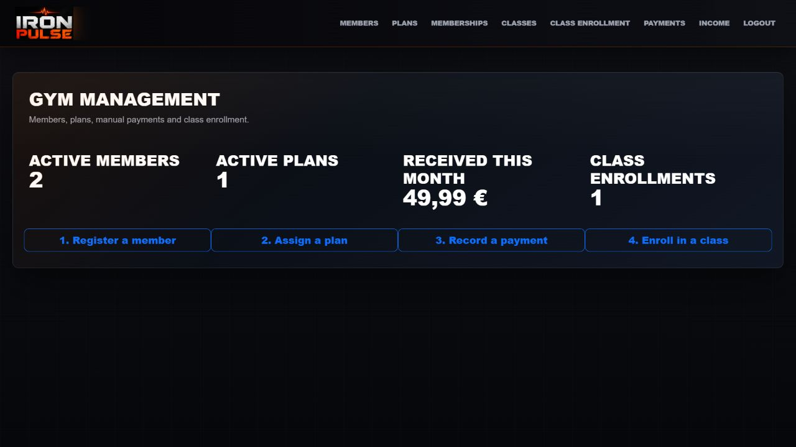
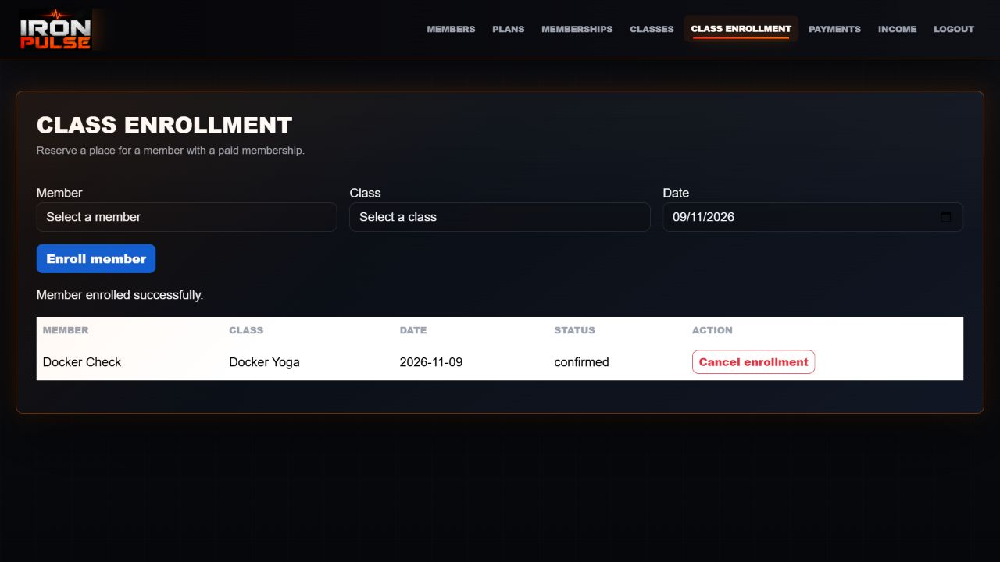

# Iron Pulse


**Gestión interna de gimnasio:** socios, planes, registro manual de cobros e inscripción a clases.

Proyecto educativo grupal desarrollado originalmente en [Bootcamp-IA-MAD-P7](https://github.com/Bootcamp-IA-MAD-P7/Project2-Grupo2), con una puesta a punto posterior centrada en cerrar los recorridos esenciales. Se conserva el historial de las contribuciones del equipo y cada mejora se explica en una PR.

## Qué hace esta versión

| Módulo | Funcionalidad |
| --- | --- |
| Socios | Alta, consulta, edición y desactivación. Los registros con historial no se borran físicamente. |
| Planes y membresías | Catálogo real con precio y duración; asignación de un plan a un socio activo. |
| Cobros manuales | Registro de importes y estados. Los pagos completados activan la membresía al cubrir el precio; devoluciones y borrados recalculan su estado. |
| Clases e inscripciones | Clases semanales con horario y aforo; inscripción de un socio con membresía pagada y vigente para la fecha; cancelación y reinscripción. |
| Resumen e ingresos | Contadores del sistema y total de cobros completados por intervalo de fechas. |

**Inscribirse a una clase reserva una plaza; no registra asistencia física.** Esta versión no tiene check-in, check-out ni seguimiento de presencia.

## Capturas de la versión esencial

Datos ficticios de la instalación de prueba.





## Verla en local

Requisitos: Docker Desktop o Docker Engine, contenedores Linux y Compose v2 reciente.

```bash
docker compose up -d --build --wait --wait-timeout 180
docker compose exec api python -m app.scripts.create_admin
```

El segundo comando prepara la primera cuenta administradora: solicita usuario y contraseña sin mostrarla. La contraseña nueva debe tener al menos 12 caracteres y como máximo 72 bytes UTF-8.

- Aplicación: [localhost:8080](http://localhost:8080).
- API interactiva: [localhost:8080/api/docs](http://localhost:8080/api/docs).
- Estado de API: [localhost:8080/api/health](http://localhost:8080/api/health).

No hace falta `.env` para la instalación local y no hay credenciales administrativas predeterminadas. Se publican únicamente servicios en loopback; PostgreSQL y la API quedan en la red de Docker. Los datos se conservan en un volumen.

```bash
docker compose down
```

El apagado normal conserva los datos. `down --volumes` los elimina y se reserva para instalaciones de prueba desechables.

## Recorrido para una entrevista

1. Crear un plan con precio y duración propios.
2. Registrar un socio y asignarle el plan. La membresía comienza pendiente.
3. Registrar un cobro completado que cubra el precio; comprobar que se activa. Se admiten pagos parciales.
4. Crear una clase con día semanal, horario y aforo.
5. Abrir **Class enrollment**, seleccionar al socio, la clase y una fecha que coincida con su día y esté cubierta por la membresía.
6. Comprobar la inscripción, cancelarla y volver a inscribir al socio. Consultar el resumen de ingresos.

Los formularios utilizan los planes y socios reales del sistema. Los precios se almacenan con dos decimales exactos. La activación financiera no equivale a procesar un pago bancario: la aplicación registra cobros realizados fuera del sistema.

## Tecnologías y estructura

- **Backend:** Python 3.11, FastAPI, SQLModel/SQLAlchemy, Alembic, PostgreSQL 15.
- **Frontend:** HTML, CSS, JavaScript y Bootstrap; sin framework de frontend.
- **Acceso:** JWT, BCrypt y creación de cuentas reservada a administradores.
- **Ejecución:** Docker Compose y Nginx como servidor de archivos y proxy de API.
- **Validación:** pytest, pruebas JavaScript y GitHub Actions con PostgreSQL y los dos despliegues Compose.

```text
Frontend/        Pantallas y JavaScript
app/             Modelos, esquemas, servicios y API
alembic/         Historial de migraciones
tests/           Pruebas de migraciones e integración JavaScript
scripts/         Verificación de despliegue Docker
nginx/           Imagen y configuración del frontend
docs/            Guías de ejecución y decisiones
```

## Pruebas y flujo de cambios

```bash
python -m pip install -r requirements-dev.txt
python -m pytest -q
node --test tests/frontend-catalog.test.cjs
```

Las pruebas de negocio usan SQLite temporal y las de acceso ejecutan autenticación real. Actions valida además migraciones y recorridos completos contra PostgreSQL con Docker. Cada PR debe pasar esas comprobaciones antes de integrarse en `developer`. `main` queda reservado para la versión final revisada.

## Documentación

- [Docker: arranque, persistencia y configuración para servidor](docs/docker.md).
- [Autenticación, administrador inicial y límites](docs/authentication.md).
- [Pruebas y alcance de la validación](docs/testing.md).
- [Alcance esencial y criterio de primera pasada](docs/essential-scope.md).

## Límites de esta primera versión

Se prioriza un recorrido funcional presentable. No se incluyen permisos detallados por operación, recuperación de contraseñas, revocación persistente del logout, optimización de grandes volúmenes ni una pasarela financiera. El frontend conserva su diseño original con las correcciones necesarias para los recorridos descritos.

La app todavía no tiene una URL pública provisionada. Antes de alojarla hay que elegir un proveedor, configurar HTTPS y copias de seguridad y revisar los límites de autenticación descritos en la guía. La privacidad del repositorio se decidirá al terminar esta primera puesta a punto; Docker no impide clonar un repositorio público.

Se retiró la funcionalidad antigua de asistencias de las pantallas y de la API. Sus datos históricos se conservan en las bases existentes y en el historial de migraciones; no son una función de esta versión.

## Futuras mejoras

Estas propuestas están únicamente documentadas y **no forman parte de la aplicación inicial**:

- Cobranza a través de un proveedor o medio de pago integrado.
- Emisión de facturas.
- Registro de asistencia mediante QR del socio, reflejado en la vista del administrador.
